# Self-describing GOAL traces

## Introduction

LogGOPSim simulates parallel applications from GOAL schedules that are first converted into a binary trace. The original binary format fixes every node record at 39 bytes with a hard-coded set of fields. Producers that need additional information, such as which GPU performs an operation, therefore reuse existing fields: they pack it into the tag or into resource IDs. The file does not record this, so producer and simulator must agree on the convention implicitly, and a mismatch silently produces wrong results.

This project replaces that format with a **self-describing, extensible** one while keeping GOAL's operations and dependencies unchanged. The file header describes every field: its name, type, width and position. Producers can add named custom fields without changing the format, each simulator checks at load time that the file supplies what it needs, and fields are packed into only as many bits as their values require. Legacy files remain readable.

The project brief sets four goals. The table shows where each is addressed:

| Goal | Question addressed | Section |
|---|---|---|
| Self-describing, extensible traces | How can the file describe compact fields and carry additional attributes? | 3.1–3.3, 4 |
| Load-time schema validation | How can a simulator check that the file supplies the values it requires? | 3.4 |
| Runtime specialization | How can decoding exploit a known schema instead of interpreting it per node? | 3.5 |
| Benchmarking | Does the new format preserve correctness and improve size or speed? | 5 |

**Status:** the format, converter, validating reader and LogGOPSim integration are implemented and tested, and ATLAHS's htsim simulator uses the same reader with a new GPU attribute (Section 4). Runtime specialization is designed but not implemented, and the performance evaluation is outstanding.

## Background

### GOAL schedules

**GOAL (Group Operation Assembly Language)** describes the computation and communication of a parallel application as a schedule. It is an intermediate format: a simulator never sees the application itself, only a GOAL schedule describing what each process computes and sends. Schedules are rarely written by hand. Separate generator tools produce them, for example:

- **Schedgen** (and its Python rewrite Schedgen2), included with LogGOPSim, generates schedules for MPI collective operations and ML-training communication patterns, and converts MPI traces recorded with the liballprof tracing library.
- **ATLAHS** generates schedules from profiled AI training runs (NCCL communication) and from HPC application traces.

Because every generator emits the same text format, any of them can feed the same simulator. GOAL has three operations:

- `send`: send a number of bytes to another rank.
- `recv`: receive a number of bytes from another rank.
- `calc`: compute locally for a given amount of simulated time.

Operations belong to numbered **ranks**, usually application processes. Within a rank, operations form a dependency graph: `requires` waits for another operation to finish, `irequires` waits for it to start. Sends and receives in different ranks are connected by message matching on source and **tag**, an integer message label chosen by the application:

```text
l1: calc 1000
l2: send 1024b to 1 tag 42
l2 requires l1
```

### Workflow: generation, conversion and simulation

Getting from an application to simulated times takes three steps, each run as a separate program:

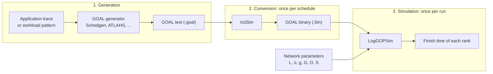

1. **Generation.** A generator produces the GOAL text from a recorded trace or a workload description, as described above. This step is outside LogGOPSim.
2. **Conversion.** `txt2bin` parses the text schedule, resolves labels such as `l1` to node indices, builds each rank's dependency graph and writes it as binary records. This happens once per schedule.
3. **Simulation.** LogGOPSim memory-maps the binary file and simulates it with a given set of network parameters. It does not parse text: it reads each node's record directly when it needs it. By default, simulation leaves the binary file unchanged so it can be reused.

The split between conversion and simulation pays off because parsing is done once while simulation is typically repeated, for example to sweep network parameters or compare network models. The binary file is the interface between the two steps, which is why its format is the subject of this project: Sections 3.1–3.3 cover the conversion side and Section 3.4 the simulation side.

### Simulation

LogGOPSim does not run the application. It walks the schedule's dependency graph and computes **when** each operation would start and finish, advancing a simulated clock. Each rank's operations are nodes in a graph. A solid edge is a local dependency: `requires` releases the dependent when the operation **completes**, `irequires` when it **starts**. Messages between ranks are not edges in the file; the simulator pairs each send with a matching receive at run time.

Every node carries a **dependency counter**: the number of its prerequisites that have not yet been satisfied. Nodes with a counter of zero at the start are the **roots**. In this example, rank 0 branches and joins again, while rank 1 receives a message and sends a reply:

```text
num_ranks 2
rank 0 {
  l1: calc 1000
  l2: send 1024b to 1 tag 42
  l3: recv 1024b from 1 tag 43
  l4: calc 100
  l2 requires l1
  l3 requires l1
  l4 requires l2
  l4 requires l3
}
rank 1 {
  l1: recv 1024b from 0 tag 42
  l2: send 1024b to 0 tag 43
  l2 requires l1
}
```

On rank 0, finishing `l1` makes both the send and the receive ready. Rank 1 receives the request before sending its reply. Rank 0's final calculation waits for both its send and its receive to finish:

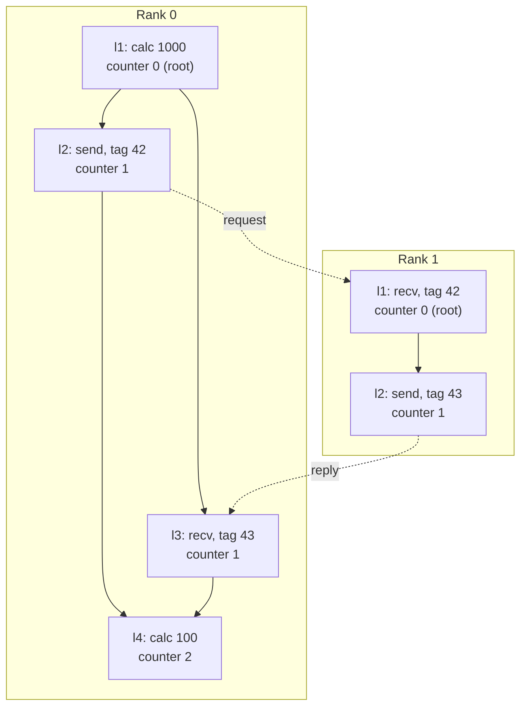

The simulator processes events in time order, starting with the root operations:


Processing an event updates the simulated time and operation state, including matching sends with receives. Satisfied dependencies reduce the waiting nodes' counters; reaching zero makes a node ready to run. The result is a predicted finish time for each rank.

This determines what a binary trace must provide for every node:

- **Operation fields** used when the node is processed: type, peer, size, tag, CPU and NIC.
- **Graph fields** used to release dependents: the dependency counter and the lists of start and completion dependents.
- **The roots** of each rank, which seed the event queue.

Two properties matter for the format. First, a node is needed only when its counter reaches zero, so nodes can be read on demand instead of all at once. Second, the dependency counters are the only values that change during the run; everything else in a node record is read-only.

### The legacy binary format

The legacy file starts with a small header containing the rank count and the largest CPU and NIC IDs. A rank table gives the start and end offsets of each rank's data. Within each rank, node and root counts and the root indices come before the node records and dependency lists:

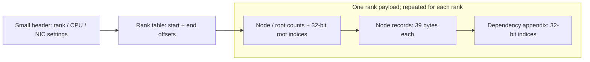

Every node record has the same eleven fields:

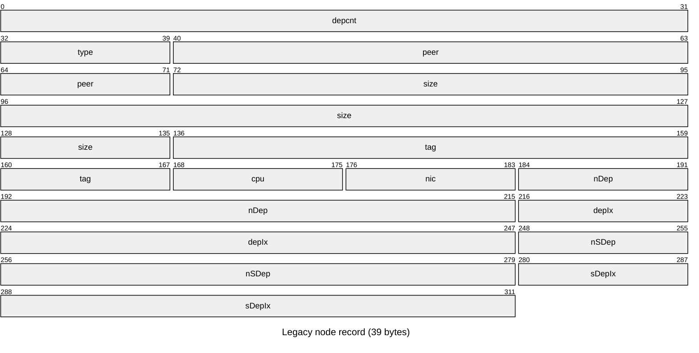

This layout has two problems. Every value occupies its full width regardless of the values that actually occur, and there is no place for additional information, so producers reuse existing fields. Section 4 shows a concrete case.

### Related work

| Source | Lesson used here |
|---|---|
| [Avro](https://avro.apache.org/docs/1.12.0/specification/#schema-resolution) | Store the writer's schema in the file and resolve the reader's requirements against it before decoding. |
| [Arrow](https://arrow.apache.org/docs/format/Columnar.html#extension-types) | Separate storage types from meaning; allow named extension fields. |
| [OTF2](https://perftools.pages.jsc.fz-juelich.de/cicd/otf2/tags/latest/html/group__records__definition.html) | Define names and types once, separately from event values. |
| [Chakra](https://github.com/mlcommons/chakra/blob/main/schema/protobuf/et_def.proto) | Core graph fields plus typed custom attributes. |
| [Cap'n Proto](https://capnproto.org/encoding.html) / [FlatBuffers](https://flatbuffers.dev/schema/) | Specify encoding, alignment and evolution rules explicitly. |
| [HyPer](https://www.vldb.org/pvldb/vol4/p539-neumann.pdf) / [Excalibur](https://www.vldb.org/pvldb/vol16/p829-boncz.pdf) | Generate specialized code for the hot path; keep a generic path alongside it and account for compile latency. |

## Design and implementation

The new design follows a trace from text to simulation. The numbers identify the relevant subsections:

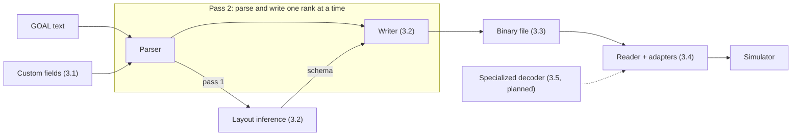

The code separates conversion from simulation: `txt2bin.cpp` coordinates parsing, layout inference and binary writing. Each simulator is a separate executable that calls the shared reader through its adapter, decoding the fields its node type needs.

The main source folders, relative to `src/LogGOPSim/`, follow these responsibilities:

| Folder | Responsibility |
|---|---|
| `goal_parsing/` | Parse GOAL text, load custom-field declarations and collect ranges and counts for layout inference. |
| `binary_writing/` | Pack records and ranks, and write legacy or self-describing binary files. |
| `trace_format/` | Define shared field types, encodings, record layouts, headers and rank tables. |
| `binary_reading/` | Validate and map binary files, decode selected fields and update dependency counters. |
| `simulators/` | Provide the shared adapter interface and graph-node base, with simulator implementations and adapters under `loggopsim/` and `atlahs/`. |

### Custom fields

Custom fields are declared in `config/custom_fields.toml`, or a TOML file selected with `txt2bin --custom-fields <file>`, each with a name and an integer type:

```toml
[[fields]]
name = "gpu_id"
type = "unsigned"

[[fields]]
name = "priority"
type = "signed"
```

Producers append `name value` pairs to every operation, in any order:

```text
l1: send 1024b to 1 tag 42 gpu_id 3 priority -2
l2: recv 1024b from 1 tag 42 priority 0 gpu_id 3
l3: calc 1000 gpu_id 3 priority 0
```

Invalid or duplicate declarations are rejected, and every declared field must appear exactly once on every operation; missing or invalid values are rejected during conversion. From then on, custom fields are treated exactly like standard fields: their ranges are collected, their widths inferred and their values packed into the same record. Legacy output cannot store them.

Custom fields currently support signed and unsigned integers. Types are defined in one module shared by parsing, statistics and the layout builder, so adding a type means extending that module, the encoding and the parser; float and string types are not implemented.

### Inferring the layout

A compact layout must be chosen before the first record is written: if tags `0..7` fit in three bits but a later rank uses tag `1000`, records already written cannot be widened. The converter therefore reads the input twice:

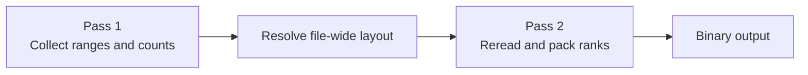

The first pass keeps only file-wide statistics: each field's minimum and maximum, whether wildcards occur, dependency counts and the largest rank's node count. The second pass parses each rank again and writes its packed records, dependencies and roots using the final layout.

GOAL input is grouped by rank. Each pass builds one rank's graph, collects its statistics or writes its binary data, then frees the graph's memory before parsing the next rank. Graphs for all ranks therefore do not need to fit in memory together, and no temporary file is needed.

This keeps graph memory bounded by the largest rank, but repeats parsing and graph construction. A single rank with a large value range also determines that field's width for the whole file. The alternatives below include ways to avoid the second parse and a way to reduce the work done in each pass.

| Approach | How it works | Main tradeoff |
|---|---|---|
| Two passes (current) | Collect ranges across all ranks, choose one layout, then parse again and write each rank. | Holds one graph at a time and needs no temporary file, but repeats parsing and graph construction. |
| Lighter passes (proposed) | Reuse the same lexer. Pass 1 collects field ranges and per-node dependency counts without building the full graph. Pass 2 builds and packs each rank using the resolved layout, without repeating range collection. | Still reads the text twice, but avoids unnecessary graph allocations in pass 1. Label tracking and dependency counts remain necessary; validation must stay complete. The speedup needs measurement. |
| Original fixed widths | Parse and write each rank immediately using predefined field widths. | Needs only one pass, but reserves space even for small values. Values outside the fixed range must be rejected. |
| Keep all graphs | Parse once and retain every rank graph. Choose the layout after the last rank, then pack the retained graphs. | Avoids reparsing and temporary I/O, but holds the entire expanded schedule in memory, including graph and allocation overhead. |
| Temporary binary file | Parse once, collect ranges and store values and dependencies temporarily. Reread them to pack the final file. | Keeps graph memory bounded and avoids a second text parse, but adds temporary storage and a full write/read. Speed depends on storage and caching. |
| Per-rank layouts (proposed) | Parse a rank, infer its local layout, write it and free its graph. The rank table locates the data; local metadata describes its layout. | One pass and potentially narrower fields, but repeated metadata and decoder setup can outweigh savings for small ranks. Requires a format change. |

The temporary-file experiment was removed. On a synthetic 2.1-million-node trace it reduced conversion time from 2.32 s to 1.71 s (1.36×), using 193 MB of temporary data. This used a warm file cache without measuring peak memory; it is not reproducible with the current code and does not establish a general speedup.

#### Field encoding

Each field is stored as an offset from the smallest observed value. A field with minimum `m` and maximum `M` uses `max(1, bit_length(M − m))` bits, and the header stores the base `m`. If a field uses the wildcard ANY (a receive from any source or with any tag), one extra code above the maximum represents it. For example:

| Values | Base | Stored codes and width |
|---|---|---|
| 1000, 1001 | 1000 | 0, 1: one bit instead of eleven |
| only 1024 | 1024 | 0: one bit |
| 0–7 plus ANY | 0 | 0–7 and 8 for ANY: four bits |

The same rule applies to the graph fields. The dependency counter's range must start at zero, because counters are decremented to zero during simulation. Dependency and root indices refer to nodes within a rank, so their width follows from the largest rank's node count. The four dependency-list fields occupy 16 of the 39 legacy bytes, so packing them matters as much as packing the operation fields.

`txt2bin --report-schema` prints the inferred layout, including every field's range, base, width and position.

**Dictionary encoding (proposed).** Offset encoding can waste bits when a field has only a few distinct values spread over a wide range. For example, `{1, 10000}` requires 14 bits with offsets. Instead, the converter could use a hash map to assign each distinct value a compact code: `1 → 0` and `10000 → 1`. Each record would then need only one bit for this field. The header would store the reverse dictionary `[1, 10000]`, allowing the reader to recover the original value by indexing it with the stored code. The codes are unique identifiers, not hash values, so hash collisions do not lose information.

This helps when a small set of values occurs repeatedly. The cost is keeping the distinct values during analysis, storing their dictionary in the header, and performing a lookup during encoding and decoding. If most values are distinct, this overhead can outweigh the savings; the converter could compare the total size with offset encoding before choosing. Supporting this requires an encoding-kind marker and dictionary support in the writer and reader. Mutable dependency counters would need special handling because decrementing a code does not decrement its original value.

### The file format

The new format keeps the same basic components: a rank table, node records, dependency lists and root indices. These still serve the same purposes as in the legacy format; the records and indices now use inferred bit widths instead of fixed widths, changing their storage sizes. The main addition is the schema in the header, which describes this encoding. The existing components are shown in grey:

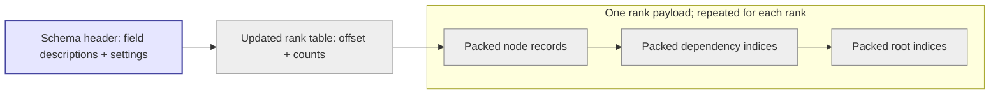

The rank counts move into the rank table, and root indices follow the dependency appendix. Records and indices use inferred bit widths. The schema header makes these encodings discoverable by the reader:

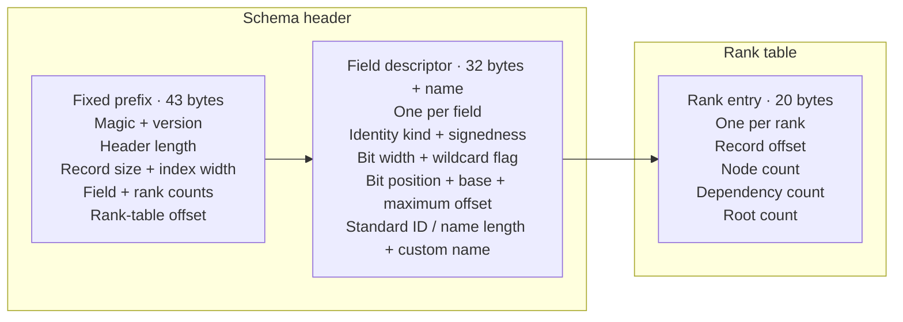

All node records in a file share one layout, so node `i` of a rank is found directly at `rank_start + i × record_size`, without scanning. Dependency and root entries are packed node indices using the file-wide index width. Multi-byte integers are little-endian and bits are numbered from the least significant bit of the first byte, so files are portable between machines.

The magic number distinguishes the new format from legacy files, which keep their own magic and are still read through the original path. Readers reject unknown versions, unknown type codes, truncated headers, overlapping fields and table entries pointing outside the file.

Legacy output remains the default for existing workflows. `txt2bin --format self-describing` selects the new format, which also supports custom fields; legacy output warns that it omits them.

### Reading through simulator adapters

Reading is configured for the simulator that will consume the nodes. The binary may contain more fields than that simulator needs: its adapter selects the fields to decode and specifies where each value goes in the simulator's node struct. Shared graph fields, such as the dependency counter, are filled automatically; other unbound fields are skipped. The same binary can therefore be read into different node types without converting it again.

#### Connection and node reads

Each simulator creates its own adapter object. The adapter provides the connection between the stored records and the simulator's input interface:

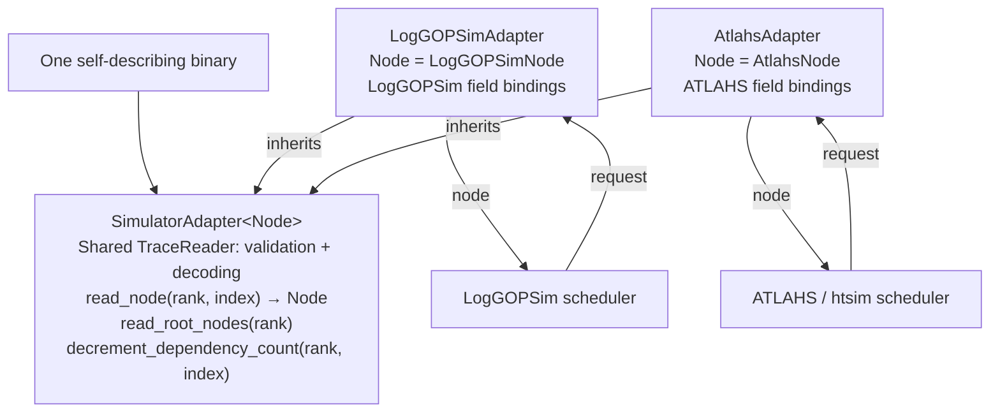

The node type tells the adapter what to return; it is not a buffer containing every node. Both adapters use the same reader implementation, but each has its own reader instance and mapping. The simulators are independent programs and can read a compatible binary concurrently using separate private mappings. Both must support its operations and message-matching convention; the explicit ATLAHS convention in Section 4 currently requires its backend.

All graph simulators' node types inherit a common base that the reader fills automatically: the node's index, its remaining dependency count, and the nodes it releases when it starts and when it completes. The adapter adds only the members its model uses, so supporting a new simulator means declaring its node type and bindings and making its input loader call the reader.

LogGOPSim itself was restructured into the first adapter. Its simulator code moved into its own directory; at startup it detects the file format and reads either legacy files through the original path or self-describing files through its adapter. Event timing, message matching and dependency processing are shared by both paths, so only storage access differs. Along the way, legacy reads were made safe for unaligned data, and empty schedules are now supported.

The procedure has four steps:

1. **Define the connection.** The adapter names its node type and binds file fields to that type's members. The member's C++ type tells the reader which values it can accept.
2. **Prepare once.** The simulator maps the file and constructs its adapter. The shared reader checks the schema against the bindings and resolves the selected fields' positions and encodings. Missing fields, incompatible types, values outside the destination type's range and unsupported wildcard representations are rejected before simulation starts.
3. **Request a node.** The scheduler calls `adapter.read_root_nodes(rank)` to get initially ready nodes, or `adapter.read_node(rank, index)` to get a particular node. The reader locates that record and decodes the bound fields directly into the chosen node type. For ATLAHS the result is an `AtlahsNode`; for LogGOPSim it is a `LogGOPSimNode`.
4. **Simulate and continue.** The simulator processes the returned node using its own timing and communication model. As prerequisites are satisfied, it updates dependency counters through the adapter and requests newly ready nodes. The scheduler decides which node to request; there is no sequential `get_next_node()` operation.

```mermaid
sequenceDiagram
  participant S as Simulator
  participant R as Adapter + shared reader
  participant F as Mapped binary
  Note over S,F: Initial handshake (once)
  S->>R: Construct once over the mapped file
  R->>F: Read schema; check bindings
  R-->>S: Ready, or reject incompatible file
  loop Node requests during simulation
    S->>R: read_node(rank, index)
    R->>F: Decode selected fields
    R-->>S: Simulator-specific node
  end
```

#### Validation before and during simulation

The schema check compares the destination member's type with the **decoded value range**. The stored bits represent an offset, and decoding reconstructs the original value as `base + offset`. For example, a 2-bit field stores offsets `0..3`; with a base of `1000`, it represents values `1000..1003`. Although the stored code fits in two bits, the decoded value does not fit in an 8-bit unsigned member. The reader therefore checks the base and maximum offset together when validating a binding.

Validation is divided between setup and individual reads:

- **At setup:** check the schema and bindings, file sections and root lists. Roots must be ordered, distinct, within their rank and initially have a zero dependency counter.
- **When reading a node:** check record bounds, dependency indices, operation codes, peer ranks and invalid send wildcards. A simulator can add checks for its own model; ATLAHS, for example, rejects messages larger than htsim supports.

#### Accessing mapped data

The reader accesses the binary through a memory mapping. The scheduler starts from each rank's roots and requests dependent nodes as their counters reach zero, so the reader decodes nodes on demand.

Dependency lists remain views into the mapped bytes rather than being copied into a new vector for every node. This avoids those allocations, but the mapping must stay alive while the lists are used. A consumer that needs a list after closing the mapping must copy its indices first. Analysis tools can also read selected field values without constructing a graph-node type.

#### Dependency counters and file reuse

Dependency counters change during simulation; the other stored node values stay unchanged. The reader currently decrements counters in the mapped bytes. With the default private mapping (`MAP_PRIVATE`), the operating system gives a process its own copy of a page when it modifies it. The original file stays unchanged, and each simulation uses a fresh mapping, allowing independent runs to reuse the same binary, including concurrently.

LogGOPSim's `--save-mem` instead uses a shared mapping: counter changes reach the file on disk, which is marked unusable for later runs. This mode is destructive and must not be used on an input shared by several simulations. ATLAHS rejects it for the new format and always uses a private mapping.

Private mappings copy whole pages even when only a counter changes. Keeping the trace read-only and storing counters separately for each run is a possible improvement; its memory and access costs still need measurement.


### Runtime specialization (TODO)

Runtime specialization would replace the shared reader's field-decoding loop with a function generated for the opened file and the simulator's bindings. The adapter would still expose the same node-reading interface, and the simulator would keep requesting nodes in the same way. This is a proposed extension; the current implementation uses the generic decoder.

#### Where it fits

The file schema and adapter bindings are already resolved at setup. Together, they determine which bits to read, how to reconstruct each value and which node member receives it. A just-in-time (JIT) decoder could turn this information into executable code once, then use that function for subsequent reads:

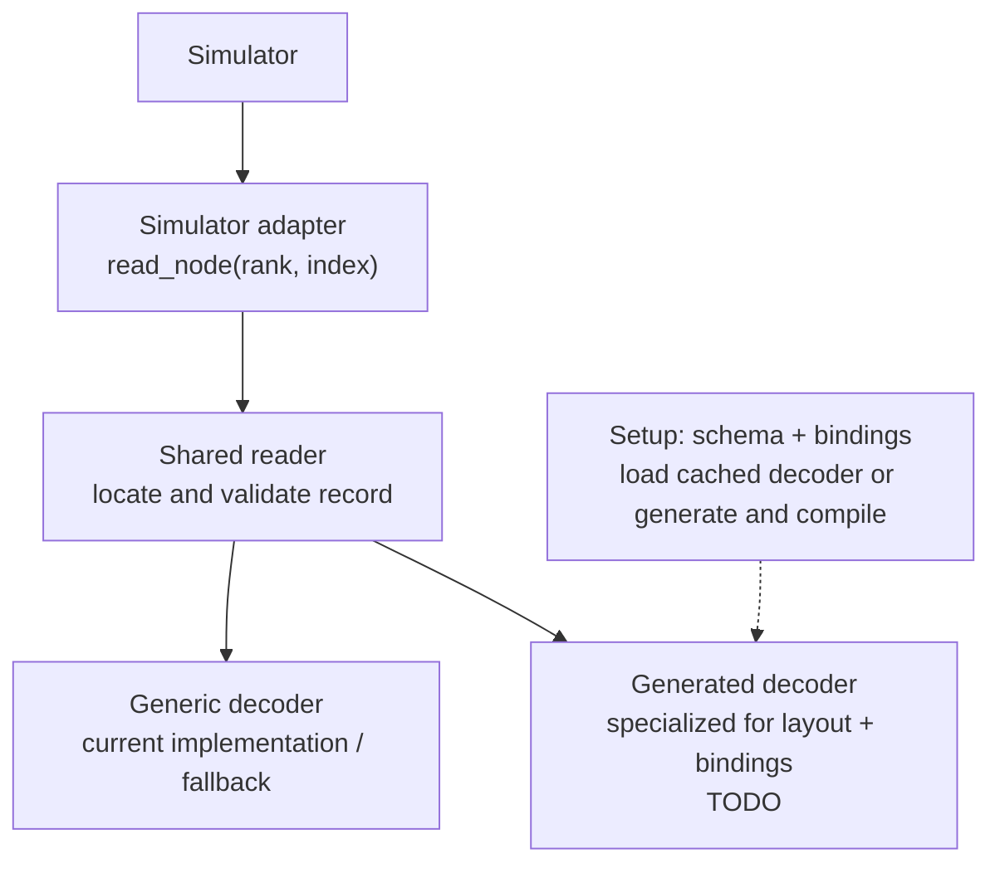

The two decoders would be alternatives behind the same reader interface. The generated function would decode the selected fields into the simulator's node type. Record bounds checks, dependency views and counter updates would stay in shared code. Each simulator would use a decoder prepared for its own bindings, even when both read the same binary.

#### Why it could be faster

The generic decoder visits the selected fields for every node, reading their positions, widths and bases from prepared metadata and invoking their assignment functions. A generated function could put these choices directly into its instructions. For a field stored at bit position 13 with width 2 and base 0, for example, it could extract those known bits and assign the result directly to `node.Gpu`.

Knowing these constants lets the compiler simplify shifts and masks, remove the per-field loop and indirect assignments, and potentially combine nearby loads. Field selection already avoids decoding unwanted values; specialization would reduce the cost of decoding the selected ones. It would not speed up message matching or network simulation directly.

#### Generating and reusing a decoder

We considered three approaches. Precompiled decoders have no runtime compilation cost but cover only layouts known at build time. An in-process JIT compiler supports arbitrary layouts but adds a large dependency. The planned approach generates C++, compiles it with the system compiler into a shared library, and loads its decoder function into the running simulator:

1. After validating the schema and bindings, look for a compatible cached decoder.
2. On a miss, generate and compile a decoder for those fields and their destinations.
3. Load the function and use it for subsequent node reads; retain the generic decoder as a fallback.

The cache identity must include the layout, bindings, destination node layout, compiler settings and target platform so that code compiled for a different node representation is not reused accidentally. Linux and macOS support compiling and loading shared libraries; Windows would need its own loading implementation.

Compilation adds startup time, and a call into a loaded library still has overhead and generally cannot be inlined into the caller. The benefit is therefore most plausible for large traces or repeated runs that reuse a cached decoder. If decoding is only a small part of simulation time, the overall gain will be limited. Implementation and evaluation remain TODO: generated and generic decoders must produce identical results, and Section 5's performance study must measure compilation, cached startup and end-to-end runtime before claiming a speedup.

## Case study: explicit ATLAHS metadata

ATLAHS provides workload generators for AI and HPC applications and the htsim packet simulator. We use it as a second consumer of the new format.

### Original encoding in standard fields

The legacy record has no GPU field. ATLAHS's NCCL generator models several GPUs per host, so it reuses three existing fields (red):

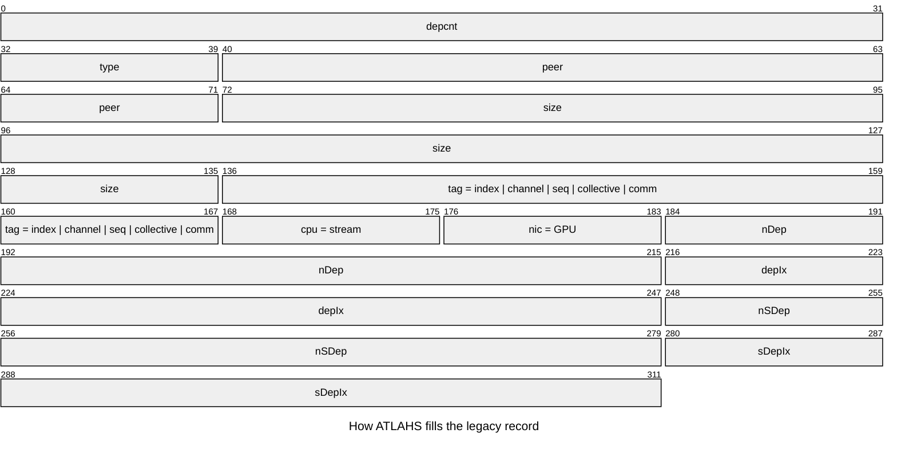

The file cannot say what these values mean: a `nic` value might be a NIC or a GPU, and the tag's components exist only in the generator's code. htsim therefore guesses the convention from the largest CPU and NIC IDs in the header. A trace that does not fit the guess is simulated with the wrong GPU mapping and no error, and a trace without GPU information cannot be rejected.

### Explicit GPU, stream and message fields

The generator now emits local and peer GPU IDs, the stream and all five message-identity components as separate attributes. The standard CPU, NIC and tag remain zero:

```text
before: l2: send 1024b to 1 tag 3050012001 cpu 0 nic 2
after:  l2: send 1024b to 1 tag 0 cpu 0 nic 0 stream_id 0 gpu_id 2 peer_gpu_id 2 chunk_id 3 channel_id 5 sequence_id 12 message_kind 0 communicator_id 1
```

The eight attributes need no change to the file format, converter or shared reader. They follow the same custom-field path:

**1. Declare.** The TOML file declares all eight attributes as unsigned integers:

```toml
[[fields]]
name = "gpu_id"
type = "unsigned"

[[fields]]
name = "communicator_id"
type = "unsigned"

[[fields]]
name = "channel_id"
type = "unsigned"

[[fields]]
name = "sequence_id"
type = "unsigned"

[[fields]]
name = "message_kind"
type = "unsigned"

[[fields]]
name = "chunk_id"
type = "unsigned"

[[fields]]
name = "stream_id"
type = "unsigned"

[[fields]]
name = "peer_gpu_id"
type = "unsigned"
```

**2. Convert.** `txt2bin` collects each field's range and chooses its width, as for standard fields.

**3. Describe.** The header stores each field's name, type, base, width and position.

For the four-GPU example trace, conversion produces this packed record layout:

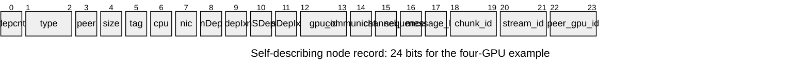

**4. Bind.** The ATLAHS adapter supplies this node type. It inherits the common graph fields and adds the operation fields and explicit metadata its scheduler needs:

```cpp
struct AtlahsNode : BaseDeserializedGraphNode {
    std::uint8_t Type = 0;
    std::uint32_t Peer = 0;
    std::uint64_t Size = 0;
    std::uint32_t Tag = 0;
    std::uint8_t Proc = 0;
    std::uint8_t Nic = 0;
    std::uint32_t Gpu = 0;
    std::uint32_t PeerGpu = 0;
    std::uint32_t Stream = 0;
    std::uint64_t Communicator = 0;
    std::uint64_t Channel = 0;
    std::uint64_t Sequence = 0;
    std::uint64_t MessageKind = 0;
    std::uint64_t Chunk = 0;
    std::uint64_t start_time = 0;
};
```

For example, this binding maps the declared `gpu_id` field to `Gpu` in the returned node:

```cpp
bind_field(std::string{"gpu_id"}, &AtlahsNode::Gpu)
```

The other seven attributes bind to `PeerGpu`, `Stream`, `Communicator`, `Channel`, `Sequence`, `MessageKind` and `Chunk` in the same way. Missing or incompatible fields are rejected at setup. `start_time` is runtime state maintained by the scheduler, rather than a stored field.

**5. Use.** `Gpu` selects the local GPU and `PeerGpu` the remote GPU; on a send these are the source and destination, respectively. `Stream` selects the execution stream. Receive matching compares the source and the `(Communicator, Channel, Sequence, MessageKind, Chunk)` tuple, and checks that both GPU endpoints agree with the receive.

With the new format htsim no longer guesses: the GPU count is the field's maximum plus one, read from the header. Legacy ATLAHS traces still work, because for them the loader copies the NIC into `Gpu` and keeps the upstream mapping.

### Integration

Declaring and binding the eight fields makes them available to ATLAHS, but its existing code also has to produce and use them. We changed three points along the path from workload generation to simulation.

#### Generator: emit the original values

Previously, the NCCL generator encoded the GPU in the NIC field and combined message-identity components into a decimal tag. The new `--explicit-fields` option writes local GPU, peer GPU, execution stream and identity components directly as named attributes on every operation. The peer GPU is resolved from the communicator's peer-rank mapping and converted to its dense host-local index, for point-to-point, ring and tree communication. This preserves their values before they enter the converter, avoiding the ambiguity of reconstructing them from overloaded fields. Calculations and fences supply zero-valued identity attributes because they do not participate in message matching. Generation without the option keeps the original output convention.

#### Input loader: construct the scheduler's nodes

The existing ATLAHS loader read legacy records using fixed byte offsets. It now detects the self-describing format and creates an `AtlahsAdapter` over the mapped file. When the scheduler needs a node, the loader obtains an `AtlahsNode` through that adapter. The shared reader handles field positions and decoding, while the adapter supplies the bindings and ATLAHS-specific checks.

This is where the generic format connects to the existing simulator: the scheduler receives the operation fields it already uses, together with explicit GPU, stream and message identity. Legacy files continue through their original reading path, with the NIC value copied into `Gpu` to preserve their GPU mapping.

#### Scheduler: use the explicit metadata

Upstream used the sender's GPU index at both network endpoints: a send from A/GPU 0 to a receive on B/GPU 2 still travelled to B/GPU 0. We added `peer_gpu_id` and changed endpoint selection to use `Gpu` at the source and `PeerGpu` at the destination. Queues and completion callbacks retain both endpoints, so matching checks the intended GPU pair and updates each host's own resource clocks. htsim's packet transport model stays the same.

Execution clocks use the explicit 32-bit `Stream` member rather than the 8-bit CPU field; the stream count comes from the schema. Legacy input retains its original routing and copies CPU IDs into `Stream` when loading nodes.

Message matching also had to change. Previously, the matcher compared numeric tags containing concatenated components. Minimum-width decimal padding did not impose a maximum component size, so different component tuples could produce the same tag. For explicit-field messages, both the waiting-receive and unexpected-message queues now compare the source and the complete `(Communicator, Channel, Sequence, MessageKind, Chunk)` tuple. The identity travels with the message through the network completion callback, so matching works whether the receive or message arrives first. Components remain unsigned 64-bit values throughout, avoiding narrowing or lossy replacement with a hash. If several queued operations match, the shared matcher selects the lowest operation index, preserving schedule order rather than relying on queue insertion order.

Legacy messages retain numeric-tag matching. Explicit-field messages require `tag 0`, message kinds keep the generator's values 0–5, and unmatched messages cause the run to fail. These checks prevent the two identity conventions from being mixed silently.

**Compatibility boundary.** The ordinary LogGOPSim matcher still supports numeric tags only, so its adapter rejects explicit ATLAHS messages. Running this particular trace in LogGOPSim would also require tuple-based matching there; accepting the file schema alone does not supply that behavior.

The modified ATLAHS source is kept as a fork pinned to a fixed upstream revision. Build instructions are in [the adapter README](src/LogGOPSim/simulators/atlahs/README.md).

Integration results, including the complete recorded-workload comparison, are reported in Section 5.1.

### Remaining conventions

Other conventions remain:

- ATLAHS also includes GOAL-generation paths for MPI/HPC workloads (`goal_gen/hpc`, using PMPI traces and Schedgen) and distributed-storage workloads (`goal_gen/storage`, using DirectDriveSim). We adapted only the NCCL generator. The others can still use the legacy simulation path, but their output cannot directly use our explicit-field ATLAHS adapter: their generators would first need to supply the required attributes with meanings appropriate to those workloads.
- GPU IDs are consecutive local indices (`0, 1, 2, …`), which the modified NCCL generator assigns automatically from the recorded GPU identifiers. The simulator maps each host/GPU pair to a network endpoint using `host_rank × gpu_count + gpu_id`, where `gpu_count` is the file-wide maximum local GPU ID plus one. The topology must therefore provide enough endpoints for this mapping: two hosts with four GPUs each require eight endpoints. Our test topologies satisfy this requirement; custom traces and topologies must use the same mapping. Hosts with fewer GPUs still reserve endpoint slots according to the file-wide GPU count.

## Evaluation

### Correctness

The automated checks cover:

- **Format components:** header and rank-table round trips, byte order, packing at every bit alignment and width, wildcards, signed and custom fields, and rejection of malformed files.
- **Conversion:** new files are decoded independently and compared field by field with legacy output, including dependency lists, roots, wildcards, multiple custom fields and 64-bit values.
- **Simulation:** on a saved reference trace (`binomialtreebcast_8`), the new format must reproduce the original simulator's per-rank finish times. Further tests cover both message arrival orders and both protocols, a regression test for the eager/rendezvous bug described below, and 60 random schedules with wildcards, start dependencies, several CPUs and NICs, mixed message sizes and custom fields, which must simulate identically in both formats under four network parameter sets.

Comparing the restructured simulator with the original also exposed an existing bug in LogGOPSim's eager/rendezvous handling. A small message is sent eagerly, without waiting for the receiver, and the sender completes immediately. If the message arrived before a larger receive was posted, which MPI allows, the receive side decided by its own buffer size that the message was rendezvous and completed the sender a second time. The original simulator let the dependency counter underflow silently and reported wrong times; in a two-rank example, a sender that should finish at 1,700 was reported at 100,000. The receive side now decides by the message's size, as the sender did.

Beyond the test suite, a one-off audit compared the new code with the original LogGOPSim on 1,480 schedules: 60 Schedgen collectives and 1,420 random graphs, each simulated with four network parameter sets. The legacy output of the new converter was byte-identical to the original's, and both formats reproduced the original simulator's results in all 5,920 simulations. This excluded the eager/rendezvous bug above. The original simulator crashed on two kinds of input: ranks without operations, which the new simulator handles, and Schedgen schedules that address non-existent ranks, which the new converter rejects with an error. The test suite also passes under AddressSanitizer and UndefinedBehaviorSanitizer, and 2,000 randomly corrupted files were each either rejected with an error message or simulated normally, without a crash.

#### ATLAHS integration

Small fixtures check individual behaviors; a recorded Llama workload checks the complete path from Nsight recordings through generation and conversion to htsim. The comparisons use htsim's NDP transport.

| Check | Coverage | Result |
|---|---|---|
| Generator | Point-to-point, ring and tree AllReduce; two hosts with four GPUs each | Explicit output converts and simulates; default output is byte-identical to upstream. |
| GPU selection | Change NIC values independently of GPU IDs; vary GPU assignments | Explicit and legacy finish times agree. Changing GPU assignments affects timing. |
| Endpoint routing | GPU pairs 0→0, 0→2 and 2→0 on two four-GPU hosts, with both arrival orders | All six cases use the expected transport endpoints and complete; inconsistent peer GPU IDs are rejected. |
| Message matching | Distinct identity components, wide values, old tag collisions and both arrival orders | Matches the unique-tag legacy reference; invalid or unmatched messages are rejected. |
| Reuse and compatibility | Repeated simulation and upstream's NDP reference test | Input remains unchanged; reference test passes. |
| Recorded Llama workload (before `stream_id` and `peer_gpu_id`) | Four hosts, sixteen GPUs; 5,680,774 operations through the original and modified pipelines | All 475,452 matched message pairs and all four host finish times agree exactly. |

Both recorded-workload pipelines disable benchmark-based reduction/copy timing. The reference uses the original converter to reproduce its historical 32-bit tag narrowing; our legacy converter rejects that overflow. The explicit-field path preserves the identity components.

### File size

| Trace | Nodes | Record size | File size |
|---|---:|---|---|
| Reference `binomialtreebcast_8` | 14 | 39 → 3 bytes | 808 → 608 bytes |
| ATLAHS four-GPU example | 8 | 39 → 3 bytes | — |
| ATLAHS Llama recording | 5,680,774 | 39 → 17 bytes | 240.6 → 111.4 MiB |

The broadcast and four-GPU examples are small enough that metadata dominates their file sizes. The recorded Llama workload gives a larger example: the packed binary is 53.7% smaller while retaining the then-current six explicit ATLAHS attributes. This historical measurement predates `stream_id` and `peer_gpu_id`. This is a size measurement; runtime performance still needs a separate study.

### Performance study (outstanding)

The planned study compares the new format with the original LogGOPSim on MPI and ATLAHS traces of different sizes and rank counts, with legacy-equivalent, narrow, wide and custom-field schemas. A smaller file pays off only if the extra conversion and decoder preparation time is less than the number of simulation runs times the time saved per run, so all of these costs are measured:

- **Size:** complete file size, including header and index arrays, for bit-packed and byte-aligned layouts.
- **Conversion:** time and peak memory of `txt2bin` for both formats.
- **Simulation:** load and validation time, decoding throughput, end-to-end runtime and peak memory.
- **Specialization:** compilation time, cached and uncached runs, and the trace size at which compilation pays off.

All runs will use the same machine, compiler and settings, report medians and 95% confidence intervals over repeated runs with cold and warm file caches, and save the scripts and trace identities for reproducibility.

## Limitations and future work

**Cheaper conversion.** Both passes currently run the full parser and build complete graphs. Section 3.2 compares lighter passes with alternatives that avoid the second text parse. Implementing and comparing these designs for conversion time, peak memory and temporary storage remains future work.

**Better compression.** Dictionary encoding, described in Section 3.2.1, remains a proposed alternative to offsets. Separately, the start-dependency position `sDepIx` always equals `depIx + nDep` and could be derived instead of stored.

**Richer metadata.** The header does not yet describe units, which operations a field applies to, default values or provenance. A canonical schema hash would let decoders be cached by layout.

**Standard field limits.** Standard fields are still limited by the parser and simulator types they are stored in, for example 32-bit tags and 8-bit CPU IDs; widening them requires changing those paths together, not only the file layout.

**Runtime specialization and evaluation**, described in Sections 3.5 and 5, remain the main outstanding work.

## Conclusion

The project replaces LogGOPSim's fixed 39-byte binary trace with a self-describing format whose header names every field and gives its type, width and position. Producers can add custom fields without changing the format, readers validate at load time that a file supplies what each simulator needs, and fields are packed into only as many bits as their values require. The ATLAHS case study makes GPU and message identity explicit, replacing overloaded NICs and concatenated tags with validated fields and tuple-based matching. Correctness is established by the test suite against the original simulator. Runtime specialization and the performance evaluation remain to be completed.

## Appendix: build and conversion

The header format is specified in `doc/binary_header.md`. The project builds with CMake 3.20 or newer and C++23; the Makefile delegates to CMake. The tests run with `ctest` from the build directory; `ctest -L unit` runs only the fast unit tests and `ctest -L integration` the end-to-end checks. Convert a trace with:

```sh
./txt2bin -i example.goal -o example.bin --format self-describing --report-schema
```

To rebuild this report after editing the Markdown, run `./report/build.sh`; see [report/README.md](report/README.md).
